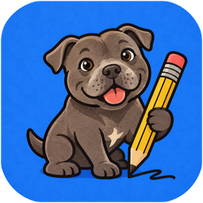
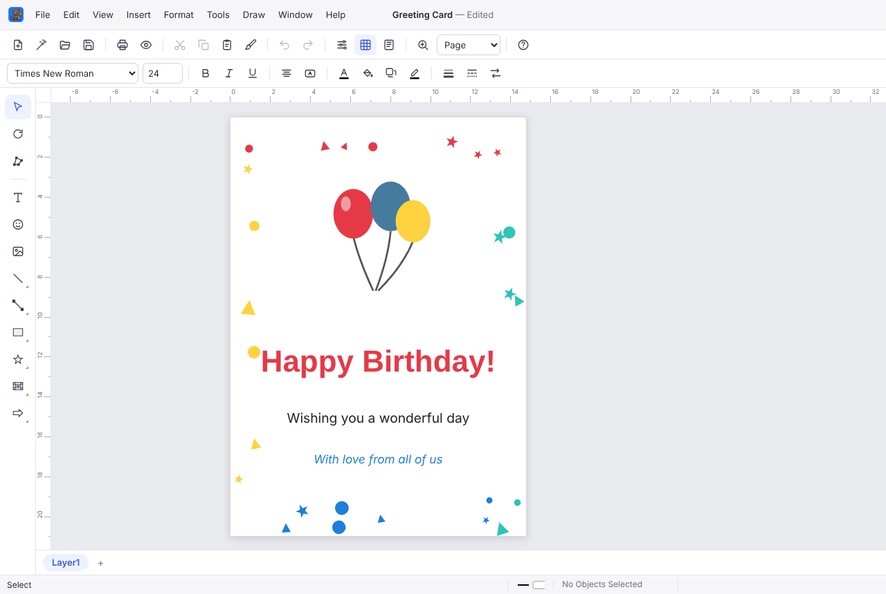

# Basil Draw 🐶

Named after Basil, the family dog. A friendly vector drawing program for the desktop, rebuilt from scratch in the spirit of
**Micrografx Windows Draw 5** (1996). The menus, toolbox, dialogs and keyboard shortcuts follow the
original closely so it feels familiar, but all the code, icons and clip art are new.



## Running it

You need [Node.js](https://nodejs.org) (version 20 or newer).

```bash
cd penguin-draw     # the project folder
npm install        # first time only — downloads Electron
npm start          # opens Basil Draw
```

### Making a real app (to give to Dad)

```bash
npm run dist:mac   # builds dist/Basil Draw-0.3.0-arm64.dmg (on a Mac)
npm run dist:win   # builds dist/Basil-Draw-Setup-0.3.0.exe (Windows, 64-bit)
```

`dist:win` works on Windows directly; on a Mac or Linux it also needs Wine (`brew install --cask wine-stable`
or `apt install wine`).

Neither build is code-signed:
- **Mac:** the first time, right-click the app and choose **Open**.
- **Windows:** SmartScreen may say "Windows protected your PC" — click **More info → Run anyway**.
  The installer asks where to install and adds Start menu and desktop shortcuts, and `.bdraw`
  files open in Basil Draw when double-clicked. Uninstall from Settings › Apps.

## What's in it

- The familiar layout — menus, toolbars, the toolbox with flyouts, layer tabs, status bar, rulers and
  the Welcome window with Tip of the Day — in a clean, modern style.
- **Project Wizard**: greeting cards, invitations, signs, certificates, business cards, banners,
  labels, post cards and calendars, each in four styles. Set your details once in
  Tools › Wizard Defaults.
- **Blend**: select two shapes and morph one into the other in as many steps as you like.
- **Drawing tools**: straight lines, polylines, right-angle lines, arcs, curves, freehand; squares,
  rectangles, rounded shapes, circles, ellipses, polygons and smoothed polygons; all 13 CoolShapes
  (cube, pyramid, cylinder, starburst, curveygon…); border frames and lines; 11 arrow shapes
  including 3D ones. Tools stay active with the floating **Finished** button, just like the original.
- **Text** objects, and **labels**: select any shape and start typing to put words in it.
- **Object Properties** (Ctrl+D) with Fill (solid, 25 patterns, 8 gradients), Line (hairline, wide,
  dashes), Line Ends (15 arrowheads), Shadow (simple, block, soft), Text and General tabs.
- Select, move, resize, **rotate and slant**, edit points, flip, align, space, center, group/ungroup,
  send to back/bring to front, layers (Layer Manager), snap to grid, zoom.
- Unlimited-ish undo (100 steps by default), cut/copy/paste between windows, format painter.
- Page Setup (screen sizes, paper sizes, cards, labels, banners, posters, custom).
- Save/open `.bdraw` files, **export to PNG, SVG and PDF**, print and print preview.
- A small library of original clip art, and Insert Picture for your own photos.

See [SPEC.md](SPEC.md) for the full feature map against the original, and what's planned next
(connector lines that stay attached, opening old `.DRW` files, folded-card printing).

## Tips for Mac users

- Wherever the menus say **Ctrl**, you can also use **⌘ Command**.
- The F-keys (F5 Group, F7 Flip, F9/F10 order…) need **fn** held down on most Mac keyboards.

## Developing

- `src/main/` — Electron main process (windows, files, printing) and the preload bridge.
- `src/renderer/` — the drawing window (plain ES modules, no build step).
  - `js/editor.js` document, selection, zoom, rendering · `js/tools.js` mouse tools ·
    `js/commands.js` every menu command · `js/shapes.js` the shape library ·
    `js/render.js` SVG rendering · `js/ui/` menus, toolbars, dialogs.
- Tests: `npm test` runs the drawing window in headless Chromium and exercises the main features
  (needs Playwright: `npm i -D playwright && npx playwright install chromium`).
  `node test/electron-smoke.mjs` launches the real Electron app.
